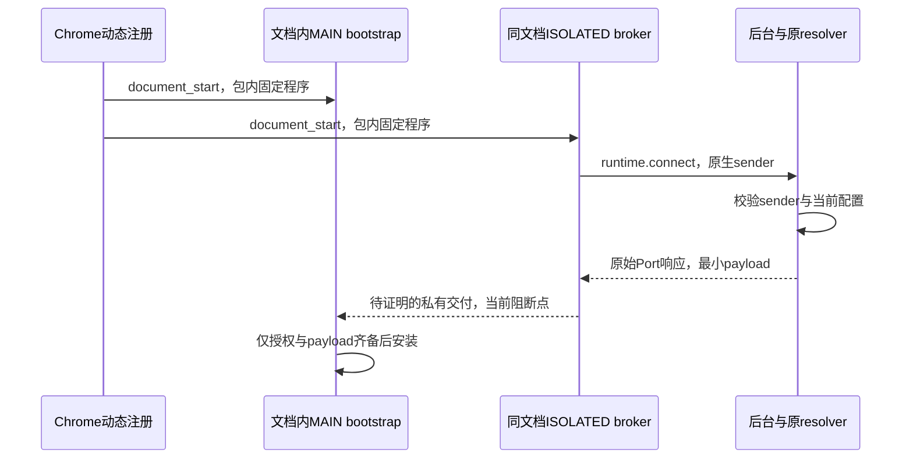

# RFC VG-020：无新增权限的替代注入架构

日期：2026-10-15。状态：**RFC交付已验收；候选机制待验证，不授权实施或生产恢复**。任务状态以[manifest](./task-manifest.yaml)为准，依赖VG-015、VG-017 done；两项已接受的NO_GO不改写。

## 1. 决策摘要

推荐下一步仅做两种机制的最小反例验证：同步配置的“注册文件序列编码”（方案F），以及异步配置的“浏览器直接注册MAIN bootstrap + 同文档ISOLATED broker”（方案B）。F首先验证小型非敏感数据能否在同一注册内同步、安全组装，以及授权撤销是否可保证；B首先验证跨world私有交付。二者均移除后台`executeScript(documentIds)`再次选址的设计依赖，但**F的组装/授权/隐私边界、B的私有交付均未证明，B还保留异步窗口**。都不能作为安全生产候选。

必须分别决定三个问题：

1. 浏览器是否将bootstrap和broker放进正确的获授权文档；后台是否只向发起请求的原始上下文响应。
2. MAIN如何确认接收者/发送者身份，页面不能伪造、窃取、转接或回放配置通道。
3. 配置到达前第一次同步API读取返回什么。提前启动空bootstrap不等于提前取得配置。

当前已有证据没有同时解决这三项。没有func/args并不构成“注册不能表达任何动态数据”的一般不可能性证明；F专门评估利用已有文件列表表达数据的可能性。若不改变当前逐文档后台授权/敏感数据边界等合同，完整恢复仍NO_GO。配置到达后生效的有限方案也必须先证明通道安全；固定配置交付是另一种产品合同，需要单独决定。

本RFC交付架构取舍和验证计划，不编写/执行新的注入spike，不改变生产代码、权限、版本、WAR、持久化schema或当前暂停。

## 2. 已证事实与边界

- [VG-015](./document-binding-research.md)：Chrome155旧documentId错投可复现；当前生产在payload读取前拒绝，暂停闸门零runtime派发通过。不能仅替换为files/frameIds或返回后检查解决。
- [VG-017](./earliest-inline-research.md)：暖/冷/受控延迟异步链路earliest均0/4，postLoad均4/4；直接动态MAIN固定getter为4/4。后者只证明固定脚本的有限fixture调度，不是动态配置、安全通道或完整runtime证据。
- 当前`RegisteredContentScript`提供包内js文件列表，没有func/args；`ScriptInjection.func`的args须JSON可序列化，不能携带后台闭包或Document引用。[Chrome scripting](https://developer.chrome.com/docs/extensions/reference/api/scripting#type-RegisteredContentScript)
- `document_start`直接脚本调度早于普通页面脚本；不假设两个不同world/不同注册之间具有未文档化的固定顺序，也不推断同源父页/旧全局尚无代码运行。[Content scripts](https://developer.chrome.com/docs/extensions/develop/concepts/content-scripts#run_time)
- MAIN共享页面环境。ISOLATED可使用扩展消息API，不能因ambient TypeScript的`chrome`存在就断言MAIN可调用privileged storage/runtime。官方描述的world隔离与MAIN页面CSP需要分别处理；MAIN直接API可用性应由P0探针及对应实现确认。[隔离及CSP](https://developer.chrome.com/docs/extensions/develop/concepts/content-scripts#content_security_policy)
- 官方Port文档说明导航卸载等情况下会断开；这不是完整BFCache/`document.open()`生命周期证明。`MessageSender.documentLifecycle`是连接创建时的快照，本机类型0.0.268也明确它可能随后改变。[Port生命周期](https://developer.chrome.com/docs/extensions/develop/concepts/messaging#port-lifetime)

本轮这些是文档/安装类型/现有代码审查结果；没有新Chrome运行证据。VG-015/017原JSON保持。公开资料核验日期为2026-10-15。

## 3. 目标、安全模型与不变量

攻击者可在目标页执行任意JS，发送/监听DOM事件、postMessage、修改页面属性，控制同源父页、opener、iframe和导航时序，并尝试把A文档的消息转接给B。还要处理正常配置撤销、后台重启和扩展更新。其他扩展的任意权限、浏览器/操作系统被攻陷不作为本RFC可解决的威胁；这不放宽对普通页面的隔离。

保持MV3及现有七项权限、host scope，不增加userScripts、debugger、webNavigation、nativeMessaging、externally_connectable或WAR。动态matches仍只由已启用allowlist派生；注册只是粗筛，不能替代后台当前配置授权。后台继续使用原config-model/resolver/storage，不建立页面域名匹配器或第二份配置事实。verified只来自既有后台确认事务。

保留禁止“页面可控配置桥”的要求。这里的“私有通道”是待证明条件，不是给postMessage加一层封装后的名称。网页可以导致拒绝/中断，不得提供被信任的payload、任意目标URL、rule、profile、权限决定或后台操作名。

发送给MAIN的最小payload不得含publicIp、provider/detection元数据、完整规则/档案列表或其他未启用信号。对启用的合成位置等实际运行参数，只承诺不额外分发；不能声称同处MAIN的网页永远无法观察伪装值。Chrome也建议限制content消息的权限和数据范围。[消息安全](https://developer.chrome.com/docs/extensions/develop/concepts/messaging#security-considerations)

## 4. 方案比较

| 方案 | 配置来源 | 文档错投路径 | 首脚本能力 | 当前决定 |
|---|---|---|---|---|
| A：原调度 + 已验证浏览器原子绑定 | 后台resolver/func args | 仍调用执行API，依赖修复构建 | 异步窗口保留 | 保留为上游路线；VG-015未取得合格构建 |
| B：动态MAIN + 同文档broker | 后台经原生Port，再经待证明私有通道 | 不再按documentId重选址；Port/交付仍需证明 | 同步API首读仍无动态payload | 仅推荐机制验证，不批准生产 |
| C：DOM/postMessage + nonce/MessageChannel/签名封装 | 仍需后台响应 | 最初交接/认证可能被页面转接 | 仍是异步 | 没有独立信任根时拒绝 |
| D：包内固定快照/有限预编译档案 | 构建时产生不可变artifact | 浏览器直接注册文件，不发旧文档调用 | 固定值有机制证据 | 技术备选，牺牲任意实时编辑/auto语义，非兼容替换 |
| E：同步读取页面storage/DOM、WAR配置资源、远端配置 | 页面或新增暴露面 | 身份/新鲜度仍未证明 | 不具备已证保证 | 不采用；页面值不可信，网络/资源方案还改变隐私边界 |
| F：注册文件序列编码配置 | 后台resolver编译为包内片段选择 | 不使用旧文档调用；改为注册快照授权 | 有同步组装的理论路径，尚未实测 | 优先最小机制证伪；敏感数据/撤销与容量问题未解决 |

“不增加权限”只是必要条件，不能据此推断信任边界、WAR、产品能力或首脚本语义等价。

### 4.1 方案F：把注册文件列表作为数据表达方式

这是新的设计假设，不是Chrome提供的配置参数。后台仍使用原resolver生成最小payload，再由一个确定性的codec把非敏感数据转换成`js`文件路径的选择/顺序。所有可能执行的程序片段提前随扩展打包；不生成用户JS、不eval、不加载远程代码，也不在运行时写扩展包。

概念顺序是`begin.js → position-0/value-a.js → position-1/value-b.js → ... → finalize.js`。片段仅携带固定字节/字段，finalize完整解码后一次性安装。官方只确认同一注册js数组按序执行；没有确认这串执行对页面/其他文档/微任务是不可插入的原子事务。以上路径只是无用户数据的示意，未生成文件或注册。

如果允许重复文件，可以研究字母表式编码；若不允许，需位置专属片段。不得把查询参数/fragment、动态文件名或不存在文件当成API已支持的参数通道。重复限制、文件数、总字节、解析成本、实际包体、注册更新成本均为待测，不能先生成庞大的文件库。无既有容量证据时，仅用几个非敏感字节验证/否定机制，遵守lean-mode，不为假设堆生成器或兼容层。

它比方案D多一个表达能力：理论上可在不重建包的情况下由后台改变片段选择；但仍有四个独立阻断：

- **组装信任**：不同文件需要共享状态。普通global/隐藏Symbol/可调用append函数不自动私有；同源父页或两文件间的可重入代码若能改写片段，便形成页面可控配置桥。必须证明完整期间不可干预、来源与顺序正确，并在任何runtime副作用前完成；校验和只能检错，不能认证页面未同时改写数据与校验值。
- **授权新鲜度**：配置提前绑定到注册快照，不再逐文档向后台取得授权。配置已禁用而旧注册/renderer缓存尚未撤销时，旧脚本可能直接安装。必须证明撤销/更新的实际提交边界，或明确接受不同的授权快照语义；不能用“最终同步”放宽当前allowlist/禁用合同。配置storage和注册更新没有本RFC已证明的原子提交。
- **容量与语义**：现有payload含任意列表/字符串/坐标等，有限片段库和浏览器资源限额未必覆盖。不得静默截断或新增任意输入上限来制造支持；若只支持部分字段/档案，需要明确产品能力决定。域名重叠/子域优先级也不能靠多个注册谁先运行决定，必须由原权威模型导出无冲突授权。
- **敏感数据**：即使每个片段文件名固定无含义，文件选择序列仍能编码数据。不得把真实IP、精确位置或凭据换一种编码放入文件URL/注册列表/日志；不能以“不是明文”绕过既有隐私边界。包含这类参数的完整payload在当前合同下不能直接采用F。未来探针只用非敏感合成位，不编译用户配置。

因此F是值得验证的同步控制面假设，不能表述为已经找到完整替代方案。若它只对非敏感、有限信号成立，和B组合也需要分别证明两条通道、共同revision及部分生效语义，不能自动升级为完整保护。

## 5. 候选B：每个文档自行启动，后台只响应原上下文

### 5.1 注册与启动

后台从原getContentScriptMatches派生两个动态注册，world分别为MAIN/ISOLATED，runAt=document_start；不靠注册返回顺序或数组排序推断跨world先后。正常生产代码暂不新增这些注册。

MAIN bootstrap只创建局部闭包和最小握手状态；配置未授权前不调用当前applyRuntime/getAntiDetectionState，因为后者会立即创建隐藏state并修改反射API。不得先安装完整hook再用flag假装“尚未生效”。必要的bootstrap通信副作用也要列入可观测行为并测量，不能把它称为零副作用。

配置尚未取得、broker缺失或注册更新失败时，拒绝新安装并给出partial/unsupported。此处“拒绝”不代表遮蔽浏览器原生值；尚未安装的同步API仍是原生，存在真实早期泄露。没有静默默认配置。

### 5.2 后台到broker

每个broker主动发起自己的`runtime.connect`；后台用`Port.sender`中的本扩展id、tab、frame、documentId、URL/origin等原生元数据，以及既有resolver判断当前授权。连接名和内容都是不可信输入，不能替代sender校验；消息体不得选择其他tab/document/rule或触发配置修改/出口确认。

只向该连接对象响应，不再通过tabs.sendMessage/tabs.connect的目标选择来重建连接，也不用`executeScript(documentIds)`运送配置。后台Map以Port对象及其受信元数据关联本次请求；documentId用于关联/审计，不成为被网页复制后即可使用的授权票据。

这改变的是寻址结构：后台持有原请求端点，而不是重新查询旧ID。**Port不会转交给替换文档、BFCache/全局重用时的端点语义，仍须P2源码和真实实验确认，不能直接视为修复证明。** 原始sendResponse也是可比较的单次端点，不能把callback仍可调用等同于实际接收Document仍正确。

### 5.3 broker到MAIN：当前缺失的信任根

普通页面消息不够。event.source===window、相同origin、isTrusted、随机事件名、nonce、Symbol、隐藏DOM节点都不能独立认证“本扩展的同文档broker”。isTrusted描述事件派发方式，不是扩展身份；page调用postMessage也不能因此成为扩展消息。[DOM isTrusted](https://dom.spec.whatwg.org/#dom-event-istrusted)、[HTML消息安全](https://html.spec.whatwg.org/multipage/web-messaging.html#security)

MessageChannel只在端点持有者已经可信时提供通信能力。若初次通过可被页面观察/争抢的window消息转移端点，通道的建立本身仍不可信。[HTML MessagePort](https://html.spec.whatwg.org/multipage/web-messaging.html#message-ports)

可以研究一次性“页面首脚本前的同步私有交接”：两个注册程序在同一文档内交换不暴露到页面的对象能力，随后移除公开交接入口。它必须同时证明跨world对象可用、交接同步、没有更早的同源父页/opener监听或原型污染、没有document.open/已有全局复用、不能重入或抢占。公开DOM事件即便同步，也不自动私有；CustomEvent.detail能否跨world携带对象/端点需实测，不能假定与结构化克隆等价。

该路径为P1待证候选：若只能证明普通top首次导航、不能处理同源父页/初始blank/重建文档，不能宣称通用方案。单纯runtime检查readyState或页面timestamp也不足以证明“握手前没有恶意代码”。无法建立私有端点时，B停止在NO_GO，不转用公开配置桥。

### 5.4 签名/加密封装为什么不是自动答案

即使传输不可信，签名也只能在MAIN已有可信公钥、后台确有受保护私钥、授权内容与实际接收文档绑定时提供来源保证。临时公钥若经同一个不可信通道送来，页面可以替换；包内静态共享密钥或可被页面取得的MAIN对象不建立可依赖的秘密边界。MAIN闭包能否安全持有随机能力与首次可信交付是不同问题，不能相互替代证明。

签名含nonce可以减少回放，但若nonce由页面可转接的请求提供，就需证明A文档不能代B索取授权。sender.documentId写进签名也不够：MAIN没有独立可信的当前Chrome documentId来比较。URL相同不能证明同一Document。签名还不能消除配置获取/验证的异步窗口；加密不能替代接收端认证。当前不建议为此加入密码学依赖或自行实现同步签名验证。

### 5.5 配置协议的条件性合同

只有P1/P2先通过，才值得确定协议。候选最小封装为`{type, protocolVersion, channelInstance, backgroundEpoch, sequence, configRevision, expiresAt, payload}`；这只是字段草案，没有新schema或消息实现。

- 信任根来自原生sender与已证明私有端点；channelInstance/epoch/sequence仅作关联、排序和失效，不替代身份。
- 后台在本次响应提交前解析当前配置；存在规则撤销/修改时，尚未提交的旧结果失效。配置revision由同一后台所有者派生，不建立第二份持久化配置。
- 内容端只接收固定类型的配置/拒绝响应，不暴露通用后台RPC或函数执行入口。网页的ack/ready只能影响可用性，不能授权配置或恢复暂停。
- 不通过window/global/DOM、URL/query、cookie、站点storage或Worker URL散发完整payload；不开调试日志输出配置。端点对象不得暴露原生runtime.Port到MAIN。
- 后台重启产生新epoch并使旧会话失效；重连不是自动对已运行页面重新建立可信bootstrap。若私有交接仅在新文档早期安全，必须要求重建文档。

## 6. 生命周期与幂等

候选本地状态是`BOOTSTRAPPED → CHANNEL_PENDING → AUTHORIZED → ACTIVE`，失败为`DENIED`；导航/端点断开/配置撤销使未提交工作进入终态。重复hello不能生成第二套state、重放响应不能覆盖新sequence，不以重复runtime调用自然幂等替代协议判断。

同URL reload、iframe移除重建必须产生新的本地端点和会话，旧回调不能复用WindowProxy指向新全局。持有Document引用并不足以覆盖document.open/write对既有对象/监听器的影响，该场景单列验证。

BFCache中documentId可能保持不变；冻结时不交付新配置，恢复后重新授权。`pagehide/pageshow`可用于保守失效，页面伪造生命周期事件不能重新授权。不能从创建时的documentLifecycle快照推断当前状态。

已经ACTIVE的hook、旧函数引用和存量worker不会因Port关闭而消失。标记`REQUIRES_RELOAD`只是状态说明；不得称已撤销。要么证明各surface的可撤销语义，要么明确接受文档存活期间的配置快照并要求重建；当前runtime语义不能被默认为已满足其中任一路线。BFCache恢复时早于重新授权的同步读取也要纳入此决定。

注册修改与撤销并非跨两个world及配置storage的原子事务。陈旧注册最多只能启动无payload的bootstrap，不能据其存在直接放行。需处理一半注册成功、持久化注册在后台尚未启动时执行、配置保存中途失败、扩展更新、旧包文件移除；未知revision不安装，明示partial。当前后台重试/签名逻辑也不得绕过安全能力判定。

## 7. 首脚本能力与产品取舍

| API类别 | 配置未到时的问题 | 可接受方向的前提 |
|---|---|---|
| language/languages、Date/Intl、同步Canvas等 | 同步调用必须立即给出值，不能等待后台 | 原生透传意味着早期泄露；默认伪值不是用户配置；完整首读保证需同步可信快照 |
| Geolocation等异步接口、部分Promise接口 | 理论上可在契约允许范围内等待配置 | 需另验超时、权限、取消、回调顺序和错误语义；不能外推到同步接口 |
| 首脚本创建的Worker/SharedWorker | 原生构造器/已创建实例不能靠后来包装追溯改写 | 要提前具备正确payload，或明确早期实例未保护 |

预装“等配置”的getter只能选择原生值、占位值、抛错或阻塞；后三者改变浏览器语义，第一种保留已知泄露。同步忙等不能使依赖消息循环的配置到达，不作为方案。异步API分阶段恢复是新的能力范围决定，本RFC不默认启动。

方案D的固定快照可以在包内文件携带合成配置并直接运行，但代价必须说清：任意用户实时编辑需重新生成/安装artifact，不能在保存后继续执行旧文件又称已同步；静态快照不得伪造持续有效的verified/auto身份。有限预编译档案也无法覆盖任意坐标、语言列表和组合；多条规则重叠时不能靠注册顺序替代resolver优先级。构建生成物可以由单一权威模型派生，不能让artifact与可编辑storage同时成为运行事实。该产品变体尚未获准，不生成含用户配置的包。

## 8. 需要单独接受的合同变化

若继续B，需明确接受：ISOLATED从只通知扩展为受限broker、MAIN从后台定向函数改为浏览器直接注册程序、新的端点/消息生命周期，以及可能“初始化后才生效”的用户承诺。若继续F，需审查逐文档后台授权改为注册快照授权、组装共享状态/编译产物、容量和敏感数据限制，不能默认弱化撤销。若继续D，需接受不可变/有限配置产品及更新方式。上述只列为RFC提案，不修改AGENTS/spec、不视为已接受规则。

schema/storage、匹配/resolver、verified身份、DNR/privacy所有权、权限与host不因调度变更自然改变。页面可控配置桥仍禁止。功能时序或配置新鲜度的弱化必须明示；仅权限不变不构成批准。

## 9. 分阶段验证计划（RFC提交时均待执行）

以下表格是RFC原始计划，不是测试结果；后续单独授权的P0-F结果见第12节。每阶段使用系统临时profile、现有权限子集、localhost合成fixture；正式生产闸门不动。候选使用计数/布尔日志，不收集真实位置/IP，不调用provider/STUN。只有前一项机制取得可信证据才扩大到下一项；若失败先保留反例并收敛，不反复延长延迟制造通过。

| 阶段 | 最小实验与对照 | 通过条件 / 停止条件 |
|---|---|---|
| P0 公开能力 | 注册MAIN/ISOLATED，探测各world实际API、跨注册顺序、严格CSP；原生/单world对照 | 形成具体版本的能力表。MAIN无privileged API不是故障；不得用新权限/WAR补齐后仍称同方案 |
| P0-F 同步序列表达 | 仅几个固定字节/开关：片段选择、重复文件、最大参数边界的定向检查；首脚本/微任务/父页抢占组装；旧注册在禁用和更新后的执行窗口 | 能正确同步还原只是第一关；页面可改写、未完成已装hook、撤销后仍执行旧授权、需要敏感数据编码或超量资源即停止对应路线 |
| P1 私有交接 | 两种启动顺序；恶意首脚本、父页/opener、srcdoc/初始blank、document.open、捕获监听/原型改写、抢占/重入/复制端点；以故意公开postMessage作为攻击有效性对照 | 正向端点可用且页面不能取得/替换/转接授权能力。任何成功伪造/截获即拒绝该设计；不能只测同origin合法消息 |
| P2 文档与端点 | 后台解析前/后延迟，A→nonmatch B、同URL reload、frame替换/删除重建、BFCache实际persisted恢复、后台停止/重启；已卸载及冻结端点 | 新文档不接收旧payload/安装state；正向当前文档成功。需核验Port原生实现和执行窗口，不能仅凭onDisconnect事件顺序证明安全 |
| P3 配置与时序 | 规则撤销/禁用/优先级变化、响应乱序/重复、注册半失败/更新；复用VG-009首inline三阶段和早期函数/Worker捕获；冷/热启动 | 分别给出授权、首读、最终调用结果。earliest FAIL保留；若同步可信payload缺失，完整恢复停止，提交有限语义决定 |
| P4 候选集成 | 仅P1/P2通过且合同明确后，对真实模块化runtime/构建验证strict/compatible、iframe、worker、SharedWorker、原生透传及DNR/WebRTC独立结果 | 不能用toy getter替代完整候选；独立安全复核、人工恢复授权均齐备后才进入生产恢复任务 |

P1重点检查的反例包括：A页面看到B的challenge后代为请求后台；A端点/已签名响应送给同URL新B；多个子帧同一origin争抢；页面用普通postMessage产生浏览器派发事件、伪造其余字段；把旧epoch包重新送入新会话。预期是拒绝或不可到达，不能把数据校验通过当来源认证。F另测篡改共享assembler、异步插入片段和同文档重入，不把能还原JSON当安全通过。

每份正式证据记录Chrome精确版本/OS、源码或候选摘要、权限对比、正负对照、采集退出码与安全判定、未验证范围。MessagePort对象、doc/tab ID、payload和配置都不进入公开JSON。完整本地门禁选择遵守仓库规则，最终候选至少源码/测试类型、npm test、build、diff、dry-run；真实Chrome按受影响边界执行，不以dry-run/VM替代。

## 10. 决策出口、回滚与当前交付

- B只有私有交付和原生端点绑定均有证据时，才值得评估有限恢复；目前二者待证，完整首读仍NO_GO。
- F只有同步组装、不可被页面干预、撤销/更新、容量及隐私门槛均明确时才值得继续；普通js数组顺序不足以证明这些条件。当前不生成片段库、不编译用户数据。
- P1若只能依赖页面可伪造桥或公共密钥的首次不可信分发，终止该候选。可以另行选择固定配置产品、受限功能或等待浏览器能力；本RFC不替用户接受这些取舍。
- 未来恢复实验失败应回到当前暂停入口与注销注册，不回到旧documentId派发。已运行文档/worker/BFCache仍需重建；不自动清除用户资料或全局关闭BFCache。
- 当前只产生文档和Trellis记录，生产后台拒绝路径、配置/权限/版本、dist/ZIP及既有证据字节不变；无数据迁移、无新增外部配置请求。
- VG-020本地RFC交付为review，人工验收pending；不启动VG-016/018/019，不提交、推送、tag或发布。RFC认可与后续隔离spike、生产恢复、发布授权分别决定。

## 11. RFC人工验收（2026-10-15）

用户确认VG-020 RFC验收通过，接受候选机制仍待验证及当前NO_GO结论，见[人工验收记录](../../.trellis/tasks/10-15-vg-020-alternative-injection-rfc/implement.md#人工验收)。manifest现为done、Trellis为completed；该确认接受RFC交付，不把任何候选提升为已验证能力，不授权启动机制实验或生产恢复。生产伪装继续暂停，不改版本、不提交、推送或发布。前文review/pending为本地交付时状态，候选取舍、验证计划与恢复门槛保持。

## 12. P0-F后续隔离验证（VG-021）

2026-10-15用户在RFC验收后单独授权P0-F；[VG-021报告](./registration-sequence-research.md)记录真实Chrome155结果。位置专属固定文件可同步表达合成4位并早于四类文档首inline；重复文件未按次数执行本探针追加，微任务可在位片段前运行。页面提交前篡改没有被本探针证明成功或不可行；禁用storage与注册注销之间已观测到旧序列安装窗口。有限表达GO，安全恢复NO_GO。该研究本地交付时为review；用户于2026-10-15确认验收通过，接受有限同步表达GO、安全恢复NO_GO及已知限制，VG-021现为manifest done、Trellis completed，见[人工验收记录](../../.trellis/tasks/10-15-vg-021-registration-sequence-probe/implement.md#人工验收)。本RFC的人工done保持，不启动其他阶段或恢复实施，生产暂停保持，不改版本、不提交、推送或发布。
